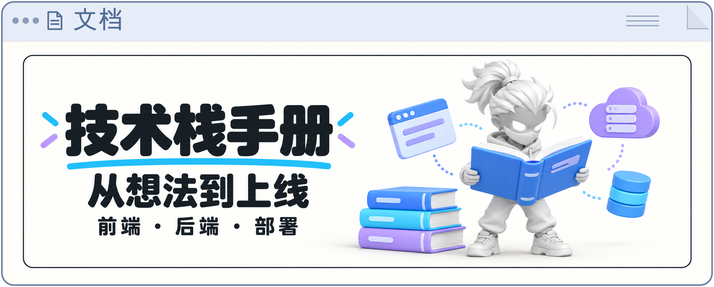

# 技术栈手册

给产品经理和学生的 AI 产品开发文档工具包。把需求、技术选型、开发和上线验收串成六个阶段，让编码 AI 按步骤执行，让你知道每一步要判断什么、验收什么。

[开始使用](开始看这里.md) · [下载完整工具包](https://github.com/17lijunyi/tech-stack-handbook/releases/latest/download/tech-stack-handbook.zip) · [PRD 模板](docs/PRD/PRD模板.md)

## 包含什么

| 内容 | 用途 |
| --- | --- |
| [操作指南](开始看这里.md) | 准备工具、发起第一次对话、中断后继续、核对交付物 |
| [AI 规则卡](AGENTS.md) | 按阶段读取手册，记录决策，以证据包和验收表推进开发 |
| [通用技术栈手册](<docs/手册/AI产品Vibe Coding通用技术栈手册.md>) | PRD 体检、后端架构、模型调用、数据持久化和效果验证 |
| [前端技术栈手册](<docs/手册/AI产品Vibe Coding通用前端技术栈手册.md>) | 页面架构、任务状态、流式输出、交互恢复、响应式和前端验收 |
| [上线部署手册](<docs/手册/AI产品 Vibe Coding 通用上线部署手册.md>) | 云平台准备、前后端部署、用户隔离、备份恢复和上线检查 |
| [PRD 模板](docs/PRD/PRD模板.md) | 用八个字段说明用户、任务、产物、效果标准、成本和数据边界 |

## 快速开始

1. 下载完整工具包并解压，为每个新产品保留一份独立副本。
2. 用能读取文件、修改代码和执行命令的编码 AI 工具打开这个文件夹。
3. 如果有 PRD，放入 `docs/PRD/`；没有也可以直接开始。
4. 发送下面这句话：

   ```text
   请读取项目根目录的 AGENTS.md，按其中“启动流程”开始。
   ```

没有 PRD 时，AI 会分轮询问，每轮不超过五个问题，整理需求后交给你确认；已有 PRD 时，从体检和补全开始。下次打开同一个文件夹、发送同一句话，就从记录的阶段继续。Claude Code 通过 `CLAUDE.md` 引用同一份规则。

也可以通过 Git 获取：

```bash
git clone https://github.com/17lijunyi/tech-stack-handbook.git
cd tech-stack-handbook
```

这是文档与规则工具包。实际开发由你使用的编码 AI 工具执行；开始阅读不需要安装应用依赖。进入具体项目后，再按手册检查 Python、Node.js、Git 和模型配置。

## 从需求到上线

| 阶段 | 会得到什么 | 你要做什么 |
| --- | --- | --- |
| 0 · PRD 体检 | 需求补全清单 | 回答关键问题，确认核心任务 |
| 1 · 技术适配 | 技术适配声明、决策台账 | 确认理解、范围与费用 |
| 2 · 后端 MVP | 核心链路、测试与真实样例 | 给样例打分，核对核心能力 |
| 3 · 正式前端 | 页面、完整交互与移动端体验 | 给视觉反馈，实际操作验收 |
| 4 · 上线 | 部署方案、访问地址与验收记录 | 配置账号，核对登录、数据与恢复 |
| 5 · 收尾 | 使用说明、交接记录 | 删除或降低临时云凭证权限 |

每个阶段交付一份证据包：**截图 + 可打开的地址或操作步骤 + 验收是否表**。未完成项保留为“否”或“待验”，模拟测试与真实模型验证分别记录。

进度保存在文件夹里，方便隔天继续或换工具接手：

```text
docs/
├── PRD/          # 模板及你的需求文档
├── 手册/         # 三份技术手册
├── 项目状态.md   # 开始项目后创建：当前阶段、决策、待确认问题
├── 阶段文档/     # 开始项目后创建：适配声明与阶段开发记录
└── evidence/     # 开始项目后创建：截图、操作步骤和验收表
```

## 使用时关注这些事

- 密钥放在本地配置或平台 Secret 中，不贴进对话，不提交到仓库。
- 有模型调用的阶段，需要真实样例验收；没有模型 Key 时如实保留“待验”。
- 创建付费云资源前，先明确费用并确认。部署手册同时说明生产档与过渡档的适用限制。
- 页面能打开只是入口检查；核心任务、用户隔离和数据恢复也要通过验收。

## 维护与校验

维护文档时，用 Python 3.11 或更新版本运行：

```bash
python3 scripts/check_docs.py
python3 scripts/package_release.py
```

第一条检查文档结构、文件链接和规则入口；第二条生成可直接解压使用的 `dist/tech-stack-handbook.zip`。GitHub Actions 会执行相同检查。本仓库的检查验证工具包完整性，具体产品的模型效果与云部署需要在各自项目中验收。

<details>
<summary>许可证与声明</summary>

采用 [MIT License](LICENSE)，版权和第三方声明见 [NOTICE](NOTICE)。

</details>
